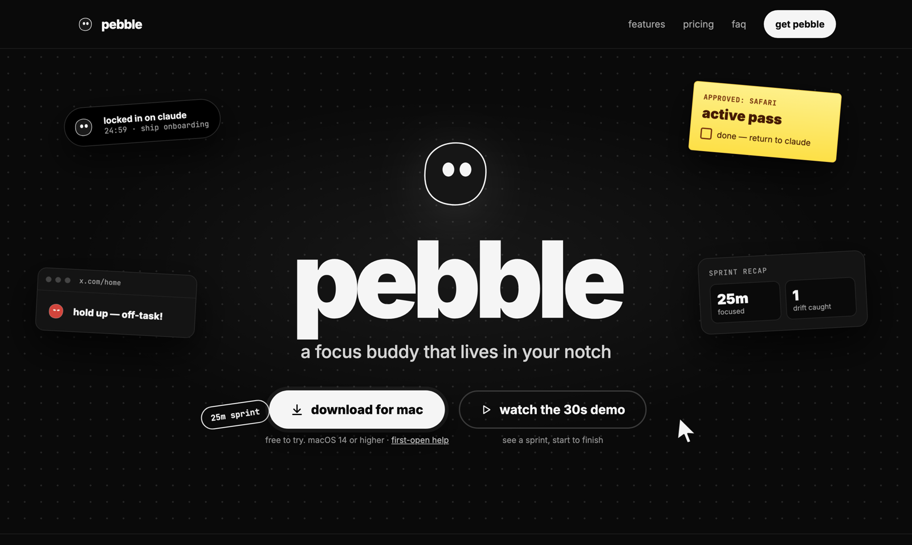
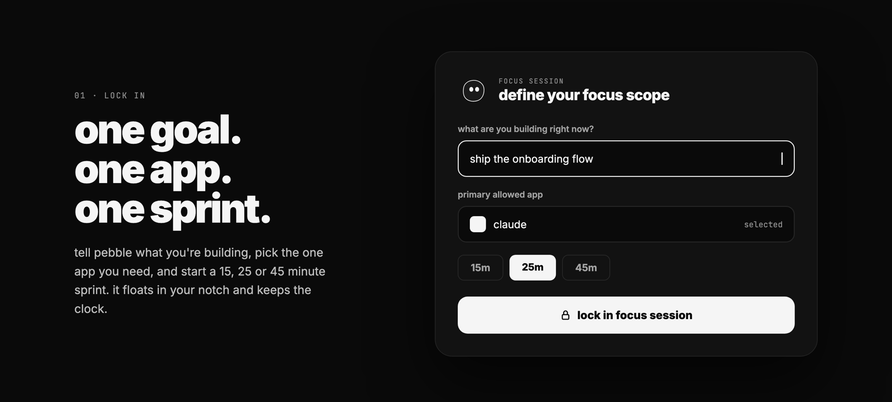
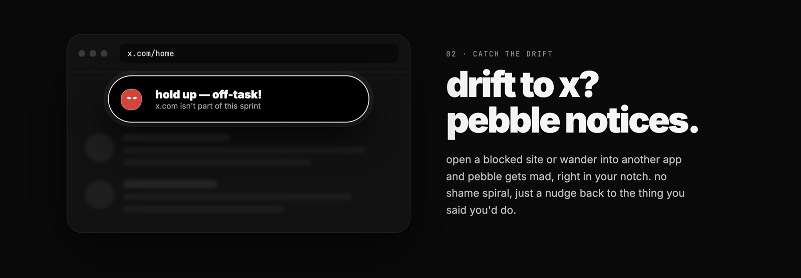
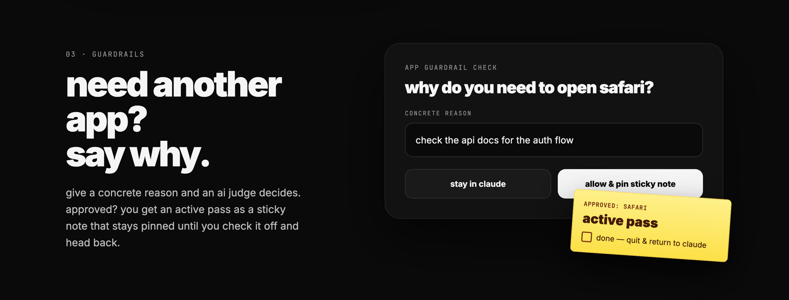
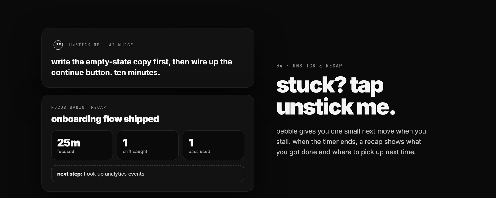
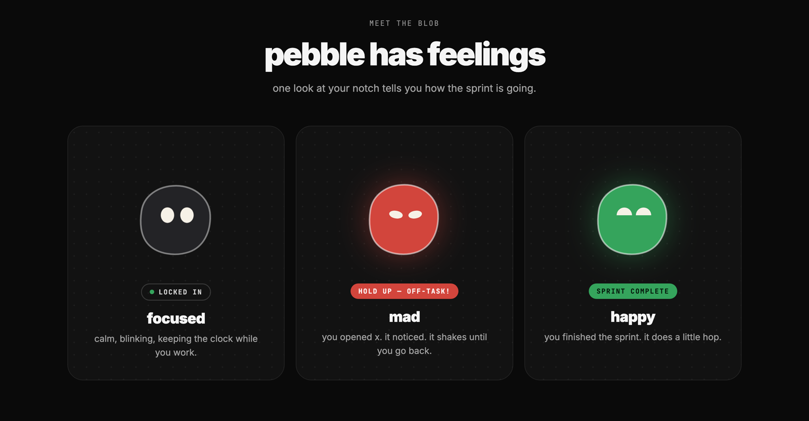

<p align="center">
  
</p>

<h1 align="center">Pebble</h1>

<p align="center">
  A focus buddy that lives in your Mac's notch.<br>
  One goal. One app. One sprint. Pebble notices when you drift.
</p>

<p align="center">
  <a href="https://pebble-focus.vercel.app/download/Pebble.dmg"><b>Download for Mac</b></a> ·
  <a href="https://pebble-focus.vercel.app">Website</a> ·
  <a href="#build-from-source">Build from source</a>
</p>

<p align="center">
  <a href="https://github.com/eldaxt3r/pebble-focus/stargazers"></a>
</p>

<p align="center">
  
</p>

Pebble is a free, open-source focus companion for macOS. It sits in your menu bar and in a Dynamic-Island-style pill under the notch. Tell it the one thing you're working on and the one app you need, start a sprint, and Pebble keeps the clock, catches distractions, and makes you say why before you open anything else.

Pebble works on **macOS 14 Sonoma or later**, on Apple Silicon and Intel Macs.

> If Pebble helps you lock in, please **[star the repo](https://github.com/eldaxt3r/pebble-focus)** ⭐. It helps other people find it.

- [Features](#features)
- [Install](#install)
- [Usage](#usage)
- [Privacy and permissions](#privacy-and-permissions)
- [Build from source](#build-from-source)
- [FAQ](#faq)
- [Project structure](#project-structure)
- [License](#license)

## Features

### Lock in on one thing
Set a goal ("What are you building right now?"), pick one primary app, and choose a 15, 25 or 45 minute countdown or an open-ended stopwatch. The timer lives in the notch.



### Drift? Pebble notices
Switch to another app or open a blocked site in Chrome, like x.com, and Pebble turns red and shakes in your notch: "Hold up — off-task!"



### Need another app? Say why
Opening something outside your sprint brings up the App Guardrail Check. Write a concrete reason and an AI judge approves or rejects it. Approved reasons get an Active Pass sticky note that stays pinned until you check it off and return to your main app.



### Unstick Me, then recap
Stalled? Tap Unstick Me for one small, concrete next move. When the sprint ends, the Focus Sprint Recap summarises what you did and suggests where to pick up.



### Pebble has feelings
Focused, mad when you wander, happy when you finish. One look at your notch tells you how the sprint is going.



## Install

1. [Download Pebble.dmg](https://pebble-focus.vercel.app/download/Pebble.dmg) and drag **Pebble** into **Applications**.
2. Open Pebble. Because it isn't notarized by Apple, macOS shows a "can't be verified" warning the first time.
3. Open **System Settings › Privacy & Security**, scroll down and click **Open Anyway**. You only do this once.

Building from source avoids the warning entirely (see below).

## Usage

1. Click the Pebble icon in the menu bar.
2. Fill in **What are you building right now?**, choose your **Primary Allowed App** and a timer, then click **Lock In Focus Session**.
3. Work. Pebble shows your goal and the time left in the notch.
4. If you need another app, answer the guardrail question. If approved, check off the sticky note when you're done to return to your main app.
5. When the timer ends, read the recap and click **Start Another Sprint**, or **Done**.

Optional settings in the setup window:

- **Chrome Distraction Radar**: add domains to block during a sprint.
- **Claude Code CLI Companion**: allow Terminal, Ghostty, iTerm2, Warp, Cursor and VS Code alongside your main app.
- **AI Guardrail Evaluator**: choose which AI command-line tool judges your reasons.

## Privacy and permissions

Pebble has no account, no server and no analytics. It asks for:

| Permission | Why |
| --- | --- |
| Accessibility | Read the active app and window title during a session |
| Automation (Google Chrome) | Read the active tab's URL to catch blocked sites |
| Screen Recording (optional) | Only if you turn on visual checks |

The AI judge, Unstick Me and the recap run through an AI command-line tool already installed on your Mac (Claude Code `claude`, `agy` or `opencode`), using your own subscription. Pebble ships no API keys and needs no `.env` file.

## Build from source

Requirements: macOS 14+, Xcode Command Line Tools (`xcode-select --install`), Swift 5.9+.

```bash
git clone https://github.com/eldaxt3r/pebble-focus.git
cd pebble-focus
./build-app.sh release
open build/PebbleCompanion.app
```

To produce the universal, ad-hoc signed `Pebble.dmg` used for downloads:

```bash
./make-release.sh
```

It builds Apple Silicon and Intel slices, merges them, signs the app without any developer identity, refuses to package if a local path or username is found in the binary, and writes `website/download/Pebble.dmg`.

## FAQ

**Is Pebble watching my screen all the time?**
No. During a session it reads window titles and your active Chrome tab. Screen recording is optional and off unless you enable visual checks.

**Who decides if my reason is good enough?**
The AI evaluator you pick (Claude Code, agy or opencode) on your Mac. Nothing goes through a Pebble server.

**Does it work on Windows or Linux?**
No. Pebble lives in the Mac notch, so it's macOS only.

**Why the "can't be verified" warning?**
Pebble is an indie app without Apple notarization. Use Open Anyway once, or build it yourself.

## Project structure

```
.
├── Package.swift              Swift package (macOS 14+)
├── Resources/Info.plist       App bundle metadata and permission strings
├── Sources/PebbleCompanion/
│   ├── App/                   App entry point, menu bar item
│   ├── Engine/                Focus session state, AI judge (CLI backends)
│   ├── Mascot/                Pebble shape, moods and animations
│   ├── Watchers/              Active app, browser tab, permissions, screen capture
│   └── Windows/               Notch island, setup, guardrail, sticky note, recap
├── build-app.sh               Debug or release .app build
├── make-release.sh            Universal, ad-hoc signed Pebble.dmg
├── website/                   Static landing page (deployed on Vercel)
└── docs/images/               README screenshots
```

## Contributing

Issues and pull requests are welcome. Please keep personal paths, API keys and credentials out of commits; `.gitignore` already excludes `.env`, keys, build output and local tooling.

## License

MIT, see [LICENSE](LICENSE).
